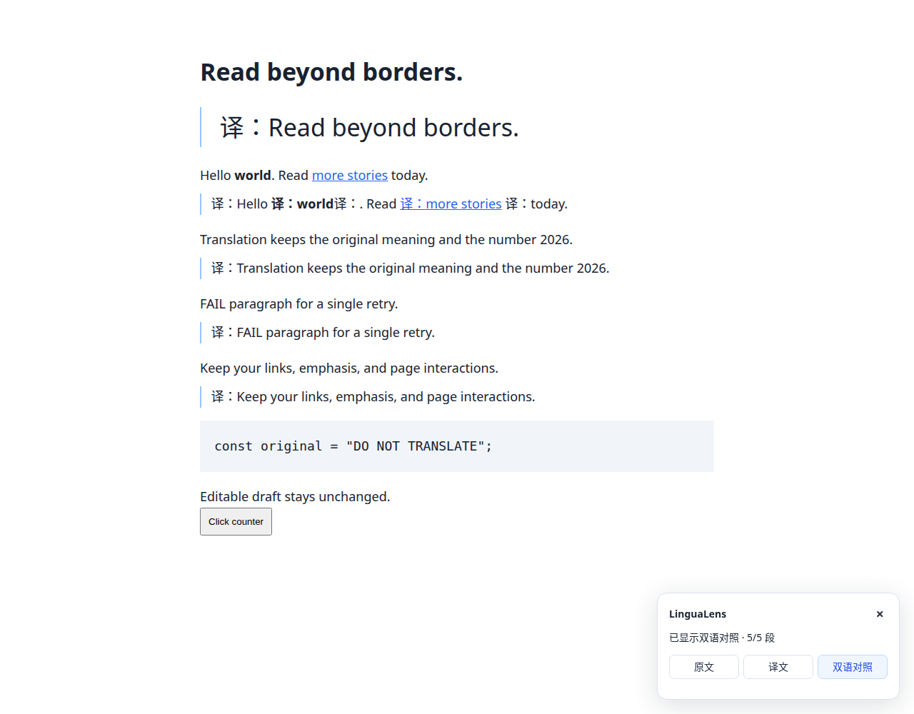

<div align="center">
  
  <h1>LinguaLens</h1>
  <p>使用自己的 AI 服务，原地翻译网页，随时还原原文。</p>
  <p>
    <a href="https://github.com/wangshub/lingualens/actions/workflows/ci.yml"></a>
    <a href="LICENSE"></a>
  </p>
</div>

## 功能

- **原地翻译**：右键翻译选区或整页，保留链接、加粗与页面交互。
- **双语对照**：保留原文，在每个自然段下方显示对应译文。
- **流式输出**：按段落分批处理，实时显示译文，失败段落可单独重试。
- **译文缓存**：原文、译文、双语直接切换，同一页面内复用已完成的译文。
- **自带密钥**：支持兼容 OpenAI API 的服务，多套配置随时切换。
- **忠实翻译**：默认约束不增译、不漏译，支持自定义 Prompt 与目标语言。

<details>
<summary>界面预览</summary>

| 设置页面 | 插件弹窗 |
| --- | --- |
|  |  |



截图使用本地模拟 API 与测试配置。

</details>

## 安装

需要 **Node.js 22.12+**、**pnpm 10.15.1** 和 **Chrome 123+**。

```bash
git clone https://github.com/wangshub/lingualens.git
cd lingualens
pnpm install --frozen-lockfile
pnpm build
```

打开 `chrome://extensions`，启用「开发者模式」，选择「加载已解压的扩展程序」，加载 `.output/chrome-mv3/`。

Chrome Web Store 版本尚未发布。获取发布包后，也可将 ZIP 解压并按上述方式加载。

## 配置

打开插件设置，填写 **API Base URL、API Key、模型名称**，选择目标语言，测试连接后保存。

| 服务 | API Base URL | 示例模型 |
| --- | --- | --- |
| OpenAI | `https://api.openai.com/v1` | `gpt-4o-mini` |
| DeepSeek | `https://api.deepseek.com/v1` | `deepseek-chat` |
| Moonshot | `https://api.moonshot.cn/v1` | `moonshot-v1-8k` |
| Ollama | `http://localhost:11434/v1` | `qwen3:8b` |

模型名称以服务商实际可用列表为准；Ollama 等免鉴权服务可留空 API Key。密钥仅保存在浏览器本地，翻译文本发送至所配置的服务。

选中文字后右键「翻译选中内容」；在页面空白处右键翻译整页或开启双语对照。弹窗和页面浮层可切换原文、译文、双语，重新翻译使用独立按钮。

Prompt、并发、错误处理与支持范围见 [配置指南](docs/CONFIGURATION.md)。

## 开发

基于 **WXT · Manifest V3 · TypeScript · React · Tailwind CSS**。

```bash
pnpm dev        # 热更新，加载 .output/chrome-mv3-dev/
pnpm check      # 类型检查、Lint、单元测试、构建
pnpm zip        # 生成安装 ZIP
```

项目结构、浏览器测试和调试方式见 [开发指南](docs/DEVELOPMENT.md)。

## 发布

修改提交后，更新版本并推送标签：

```bash
npm version patch && git push --follow-tags
```

GitHub Actions 自动检查、打包并创建 Release；配置商店凭据后通过 V2 API 提交 Chrome Web Store 审核。首次上架、CLI 授权与 Secrets 配置见 [发布指南](docs/RELEASING.md)。

---

[MIT License](LICENSE) · [隐私说明](PRIVACY.md) · [完整源码](docs/CORE-SOURCE.md) · [验证记录](docs/verification.md)
